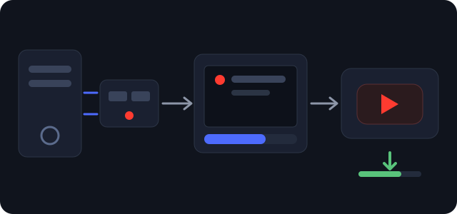

# PS5 录制 + YouTube 自动上传

把「PS5 → 采集卡 → OBS 录制 → 整理成片 → 上传 YouTube」收进 DeepSeek Harness 侧边栏的一个按钮。

本仓库包含一个可直接安装的 **DeepSeek Harness（DSH）插件**、完整的中文使用说明、调研资料和开发调试脚本。



## 功能

- **一键开录**：填游戏英文名，点「开始录制」；自动启动 OBS、按 1080p60 / H.264 / MKV 录采集卡画面，并自动打开游戏音频。
- **暂停 / 继续 / 停止**：暂停片段不入成片，一段录制 = 一集。
- **自动整理**：停止后用 ffmpeg 无损转封装为 MP4，按 `游戏 | EP 01` 命名，并抽帧生成封面。
- **确认后上传**：成片先进入「待确认上传」，点「确认上传」才发到自己的 YouTube 频道；也可开启「停止后自动上传」。
- **上传能力**：标题/简介/标签/可见性/播放列表可设，支持断点续传、失败重试、队列持久化，上传完成弹出可点击的 Studio 卡片。
- **高画质录制**：写入 OBS 硬件编码器质量（默认 85，可调 1–100），录制前自动应用。
- **零 npm 依赖**：WebSocket、OBS 控制、OAuth、上传全部用 Node 内置模块实现。
- **本机优先**：OAuth 密钥与令牌只存 `~/.dsh/ps5-recorder/`，不经过第三方服务器。

## 目录结构

| 路径 | 说明 |
| --- | --- |
| `ps5-recorder/` | 插件本体（可直接被 DSH 安装） |
| `ps5-recorder/index.js` | Host 半：OBS 控制、成片整理、上传队列、HTTP API |
| `ps5-recorder/client.js` | React 面板：主面板 + 侧边栏入口 |
| `ps5-recorder/lib/` | WebSocket、OBS、ffmpeg 管线、YouTube 上传、状态存储 |
| `ps5-recorder/docs/` | 插件详情页文档与预览图 |
| `dev-tools/` | 开发调试脚本（录制、转封装、上传链路、UI 冒烟等） |
| `research/` | YouTube 上传事实核查、DSH 插件契约等调研笔记 |
| `evidence/` | 实测截图（暂停前后画面、真实 PS5 画面、自动封面） |
| `使用说明.md` | 面向使用者的完整中文手册（配置、日常使用、排障） |

## 换电脑后怎么恢复

### 1. 克隆仓库

```bash
git clone https://github.com/Ol1iv3r/ps5-recorder.git
cd ps5-recorder
```

> 仓库是私有的，新电脑上先登录有权限的 GitHub 账号；也可以用 `gh repo clone Ol1iv3r/ps5-recorder`。

### 2. 安装基础环境

```bash
# macOS
brew install ffmpeg
# 另需安装 OBS Studio（自带 obs-websocket v5）与 DeepSeek Harness
```

PS5 需关闭 HDCP：`设置 › 系统 › HDMI › 启用 HDCP` → 关闭。

### 3. 把插件装进 DSH

在 DeepSeek Harness 里让 AI 执行（或使用插件管理界面安装本地插件）：

```text
plugin_manager({ action: 'install_bundle', target: '<仓库绝对路径>/ps5-recorder' })
```

安装后刷新 DSH 页面，侧边栏会出现「PS5 录制」图标。首次使用按 `使用说明.md` 第三节配置 Google Cloud OAuth 客户端并连接 YouTube。

### 4. 恢复个人数据（可选，不随仓库同步）

| 内容 | 位置 |
| --- | --- |
| 成片、封面 | `~/Movies/PS5/` |
| 设置、集数、上传队列 | `~/.dsh/ps5-recorder/state.json` |
| YouTube 令牌（0600） | `~/.dsh/ps5-recorder/youtube-tokens.json` |

这些是本机运行时数据，**没有**提交到 Git。新电脑上重新连接一次 YouTube 即可；如需保留集数，可手动拷贝 `state.json`。

## 和 AI 一起继续开发

仓库根目录的 [`AGENTS.md`](AGENTS.md) 给 AI 助手准备了项目地图、运行方式、约束和排障入口。换电脑后直接把仓库路径告诉 AI，并说「读 AGENTS.md 和 使用说明.md，继续开发 / 帮我配置」，即可快速接上上下文。

常用入口：

- 需求与现状：`使用说明.md`
- 插件实现与安装：`ps5-recorder/README.md`
- 接口契约：`research/dsh-plugin-contract.md`
- YouTube API 细节：`research/youtube-upload-facts.md`
- 调试脚本：`dev-tools/`（多数需要本机 OBS、ffmpeg 或 DSH 正在运行）

## 安全说明

- 不要提交 `~/.dsh/ps5-recorder/` 下的 `state.json`、`youtube-tokens.json`，也不要提交任何 OAuth 客户端密钥。
- 仓库内的 `.gitignore` 已排除令牌、状态、录制成片与依赖目录。
- 撤销 YouTube 授权：面板「断开」，或访问 <https://myaccount.google.com/permissions>。

## 已验证 / 已知限制

已实测：真实 PS5 画面与声音录制、OBS 冷启动、暂停续录、自动转封装与命名、封面生成、队列断点续传、真实上传到 YouTube（12 秒测试片段）。细节与已知限制见 `使用说明.md` 第六节。

## License

个人项目，未附开源许可证；如需复用请先联系仓库所有者。
